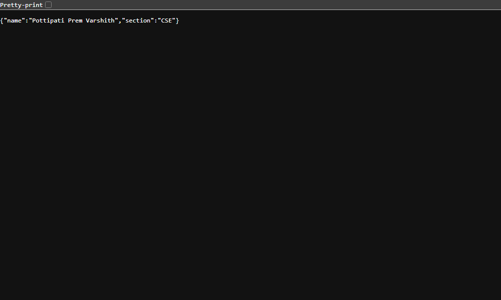
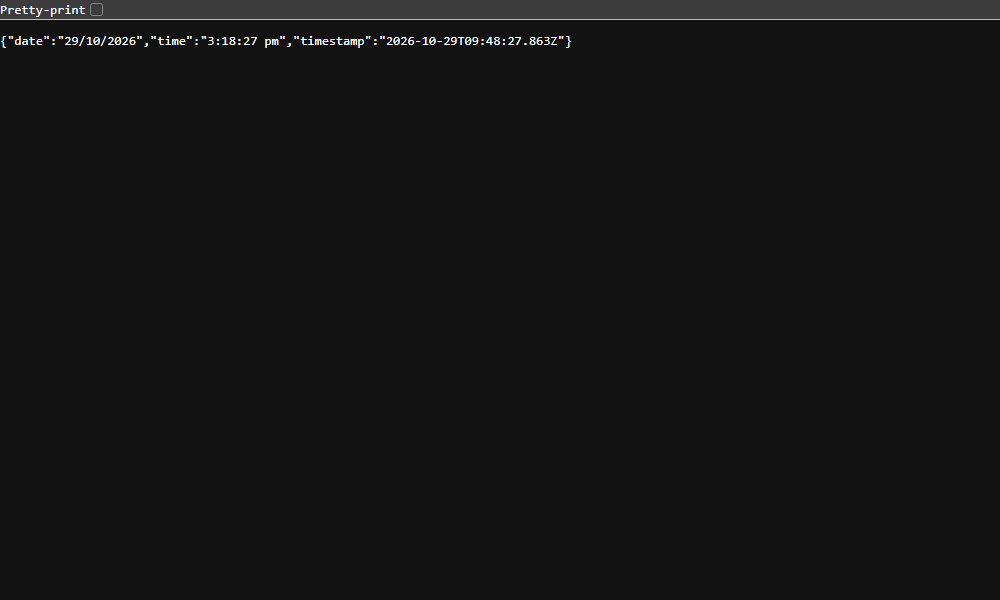

# 🚀 Backend Development Lab — Node.js & Express.js

<p align="center">
  
  
  
  
</p>

<p align="center">
  <b>A hands-on backend development project exploring HTTP servers, Express.js routing, request handling, and HTTP status codes.</b>
</p>

---

## 👨‍💻 Student Information

| Detail | Information |
|:---|:---|
| **Name** | P.PREM VARSHITH |
| **Registration Number** | 252U1R1200 |
| **Section** | CSE-2D |
| **Technology** | Node.js & Express.js |
| **Lab Experiment** | Lab 1 — Node.js and Express Server |
| **Deployment Platform** | VERCEL |

---

## 🌐 Live Deployment

### 🚀 Try the Application

**[Open Live Application →](https://abd-lab-1-1.vercel.app/)**

Explore the deployed server and test its endpoints.

| Endpoint | Description | Live Demo |
|:---|:---|:---|
| 🏠 Home | Displays the welcome response | [Visit Home](https://abd-lab-1-1.vercel.app/) |
| ℹ️ About | Displays student information | [Visit About](https://abd-lab-1-1.vercel.app/about/) |
| 🕒 Date & Time | Returns the current date and time | [Check Date & Time](https://abd-lab-1-1.vercel.app/time/) |
| ❌ 404 Handler | Demonstrates handling of unknown routes | [Test 404 Response](https://abd-lab-1-1.vercel.app/undefined/) |

> **Note:** The application may take a short time to respond if the hosting service has put it to sleep. The links above are the configured deployment URLs; their current availability has not been independently verified.

---

## 📌 Project Overview

This project demonstrates the fundamentals of backend development using **Node.js and Express.js**.

It begins with creating a basic HTTP server using Node.js's built-in `http` module and progresses to building an Express application with multiple routes and a custom 404 handler.

The project helps develop a practical understanding of how servers receive requests, process URLs, generate responses, and communicate with clients through HTTP.

### 🎯 Objectives

- Understand the fundamentals of Node.js.
- Create an HTTP server using the built-in `http` module.
- Initialize and configure a Node.js project using npm.
- Build a backend application using Express.js.
- Implement GET endpoints for different resources.
- Generate dynamic date and time responses.
- Handle invalid URLs with an appropriate HTTP 404 status.
- Test endpoints and inspect HTTP response status codes.
- Deploy a backend application using Render.

---

## ✨ Features

- **Express Server:** A lightweight backend server built with Express.js.
- **Multiple Routes:** Dedicated endpoints for the home, about, and time pages.
- **Dynamic Responses:** Generates the current date and time when requested.
- **Custom 404 Handling:** Returns an appropriate response when a route does not exist.
- **Native HTTP Server:** Demonstrates server creation without Express.js.
- **npm Scripts:** Simplifies starting the Express and native HTTP servers.
- **Cloud Deployment:** Makes the application accessible through a public URL.
- **HTTP Status Verification:** Tests successful requests and missing routes.

---

## 🛠️ Technology Stack

| Technology | Purpose |
|:---|:---|
| [Node.js](https://nodejs.org/) | JavaScript runtime for backend development |
| [Express.js](https://expressjs.com/) | Web framework for routing and handling requests |
| [npm](https://www.npmjs.com/) | Package and dependency management |
| JavaScript | Server-side application logic |
| HTTP | Communication between clients and the server |
| [Render](https://render.com/) | Cloud hosting and deployment |

---

## 📂 Project Structure

```text
BDF-Labs/
│
├── README.md
│
└── lab-01/
    │
    ├── README.md
    ├── package.json
    ├── package-lock.json
    ├── server.js
    ├── http-server.js
    │
    └── screenshots/
        ├── home.png
        ├── about.png
        ├── time.png
        └── 404.png
```

> **Important:** This is the expected structure based on the project description. Keep only the files and screenshots that actually exist in your repository.

### 📄 File Descriptions

| File | Purpose |
|:---|:---|
| `README.md` | Documents the project and provides setup instructions |
| `lab-01/README.md` | Contains experiment-specific instructions and evidence |
| `server.js` | Implements the Express server, routes, and 404 handler |
| `http-server.js` | Demonstrates creating a server using Node.js's built-in HTTP module |
| `package.json` | Defines project metadata, scripts, and dependencies |
| `package-lock.json` | Records the dependency tree for reproducible installations |
| `screenshots/` | Stores screenshots of tested endpoint responses |

---

## ⚙️ Installation and Setup

Follow these steps to run the project on your local machine.

### Prerequisites

Install the following:

- [Node.js and npm](https://nodejs.org/)
- [Visual Studio Code](https://code.visualstudio.com/) or another code editor
- A web browser
- Command Prompt or a terminal

Verify your installation:

```bash
node --version
npm --version
```

### Step 1: Clone the Repository

```bash
git clone <YOUR_GITHUB_REPOSITORY_URL>
```

Navigate to the project directory:

```bash
cd BDF-Labs/lab-01
```

Replace the repository URL and folder names with the actual values used in your GitHub repository.

### Step 2: Install Dependencies

```bash
npm install
```

This command installs the dependencies specified in `package.json`.

### Step 3: Start the Express Server

```bash
npm start
```

Open the following address in your browser:

```text
http://localhost:3000
```

### Step 4: Run the Native HTTP Server

Stop the Express server if it is using the same port, then execute:

```bash
npm run plain
```

Open the local server address again:

```text
http://localhost:3000
```

The native HTTP server demonstrates how Node.js can handle HTTP requests without an external web framework.

> **Note:** The commands above assume your `package.json` defines the `start` and `plain` scripts and that the server listens on port 3000 by default.

---

## 🔗 API Endpoints

The application exposes the following routes:

| HTTP Method | Endpoint | Expected Status | Purpose |
|:---|:---|:---:|:---|
| GET | `/` | 200 OK | Returns the home-page welcome response |
| GET | `/about` | 200 OK | Returns information about the student |
| GET | `/time` | 200 OK | Returns the current date and time |
| GET | `/unknown` | 404 Not Found | Demonstrates handling of an undefined route |

### 1. 🏠 Home Route

**Endpoint:** `/`

**Method:** `GET`

Returns a welcome message from the backend application.

### 2. ℹ️ About Route

**Endpoint:** `/about`

**Method:** `GET`

Returns information associated with the project or student, depending on the response implemented in `server.js`.

### 3. 🕒 Date and Time Route

**Endpoint:** `/time`

**Method:** `GET`

Returns the current date and time generated by the server.

### 4. ❌ Custom 404 Route

**Endpoint:** `/unknown`

**Method:** `GET`

When a requested path does not match a defined route, the application returns a 404 Not Found response.

This demonstrates why unknown routes should be handled explicitly.

---

## 🧪 Testing and Verification

You can test the application through a browser or by using the `curl` command.

### Test the Home Route

```bash
curl -i http://localhost:3000/
```

### Test the About Route

```bash
curl -i http://localhost:3000/about
```

### Test the Date and Time Route

```bash
curl -i http://localhost:3000/time
```

### Test the 404 Handler

```bash
curl -i http://localhost:3000/unknown
```

The `-i` option displays the HTTP response headers along with the response body.

### Expected HTTP Status Codes

| Status Code | Meaning | Application Scenario |
|:---:|:---|:---|
| `200 OK` | Request succeeded | A valid endpoint is accessed |
| `404 Not Found` | Requested resource does not exist | An undefined endpoint is accessed |

These are the expected results; confirm the actual responses against your running application.

---

## 📸 Screenshots and Evidence

Add screenshots of your actual application responses to the `lab-01/screenshots/` directory.

### 🏠 Home Route


### ℹ️ About Route



### 🕒 Date and Time Route



### ❌ 404 Not Found


> If your screenshot filenames or folder structure differ, update the image paths accordingly. GitHub displays these images only when the referenced files exist.

---

## 🧠 Key Concepts Learned

### 1. Node.js

Node.js allows JavaScript to run outside the browser and supports building server-side applications.

### 2. Express.js

Express.js simplifies backend development by providing convenient methods for defining routes and handling HTTP requests.

### 3. HTTP Request and Response

- **Request (`req`):** Contains information sent by the client, including the URL, HTTP method, and headers.
- **Response (`res`):** Provides methods to send response data and set HTTP status codes and headers.

### 4. Routing

Routing determines how the application responds to requests made to particular URL paths.

### 5. Middleware

Middleware functions can execute during the request-response cycle. A fallback handler placed after the application's defined routes can handle requests that did not match those routes.

### 6. npm and `package.json`

`package.json` stores project metadata, dependencies, and scripts.

The `node_modules` directory contains installed packages and is normally excluded from version control.

### 7. HTTP Status Codes

Status codes communicate the outcome of an HTTP request to the client.

For this experiment, the main codes are `200 OK` and `404 Not Found`.

### 8. Server Listening

The `app.listen()` method starts the Express server listening for incoming connections on the configured port.

---

## 🛠️ Problems Faced and Solutions

During the development process, I worked through the following challenges.

| Problem | Solution |
|:---|:---|
| Incorrect directory navigation | Checked the current working directory and navigated to the correct project folder. |
| Project folder organization | Corrected the directory structure to keep the lab files in the appropriate locations. |
| Initializing the Node.js project | Used `npm init -y` to generate the initial `package.json` file. |
| Installing Express.js | Executed `npm install express` to install the required framework and dependencies. |
| Implementing multiple endpoints | Defined individual Express route handlers for the home, about, and time routes. |
| Handling unknown URLs | Added a fallback handler after the defined routes to return a 404 response. |
| Verifying HTTP status codes | Tested the routes using a browser and `curl -i`. |
| Preparing the deployment | Configured the application for hosting on Render and documented the public endpoints. |

These challenges helped strengthen my understanding of project setup, backend routing, request handling, and application testing.

---

## 🎓 Viva Preparation

**Q1. What is Node.js?**

Node.js is a JavaScript runtime that allows JavaScript code to execute outside a web browser.

**Q2. What is Express.js?**

Express.js is a web framework for Node.js that simplifies routing, middleware, and HTTP request handling.

**Q3. What is the purpose of `package.json`?**

It stores project metadata, dependencies, and scripts used to manage and run the application.

**Q4. What is the difference between `package.json` and `node_modules`?**

`package.json` declares dependencies and project configuration, whereas `node_modules` contains the installed packages.

**Q5. What is routing in Express.js?**

Routing defines how an application responds to requests for particular paths and HTTP methods.

**Q6. What is the purpose of `app.listen()`?**

It starts the Express application listening for incoming requests on a specified port.

**Q7. What is an HTTP 404 status code?**

It indicates that the server cannot find the requested resource.

**Q8. What is the difference between Node.js's HTTP module and Express.js?**

The built-in HTTP module provides lower-level tools for creating HTTP servers, while Express.js offers higher-level abstractions for routing and request handling.

**Q9. What is the purpose of `npm install`?**

It installs the dependencies required by the project.

**Q10. How can you verify an HTTP status code?**

You can inspect the response in browser Developer Tools or use `curl -i` from the terminal.

---

## 🚀 Future Improvements

Potential extensions for future experiments include:

- Adding POST, PUT, and DELETE endpoints.
- Implementing request validation.
- Connecting the backend to a database.
- Introducing structured error handling.
- Adding automated API tests.
- Implementing authentication and authorization.
- Improving deployment monitoring and logging.

These are possible future enhancements and are not claimed as features of the current lab.

---

## 📚 Learning Outcome

Through this lab experiment, I gained practical experience with Node.js, Express.js, HTTP server creation, REST-style routing fundamentals, response handling, status-code verification, and cloud deployment.

The experiment established a foundation for developing more advanced backend applications and APIs.

---

<p align="center">
  <b>Built with Node.js & Express.js</b>
  <br>
  <i>P.PREM VARSHITH | CSE-2D | 252U1R1200</i>
</p>
