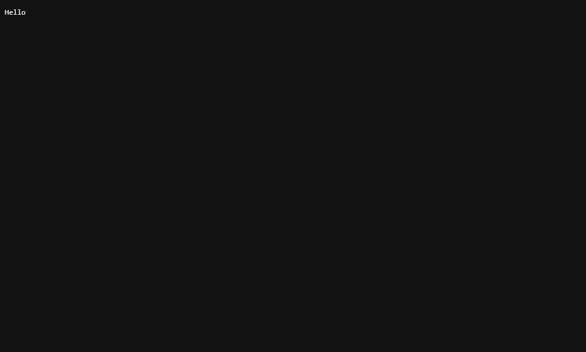
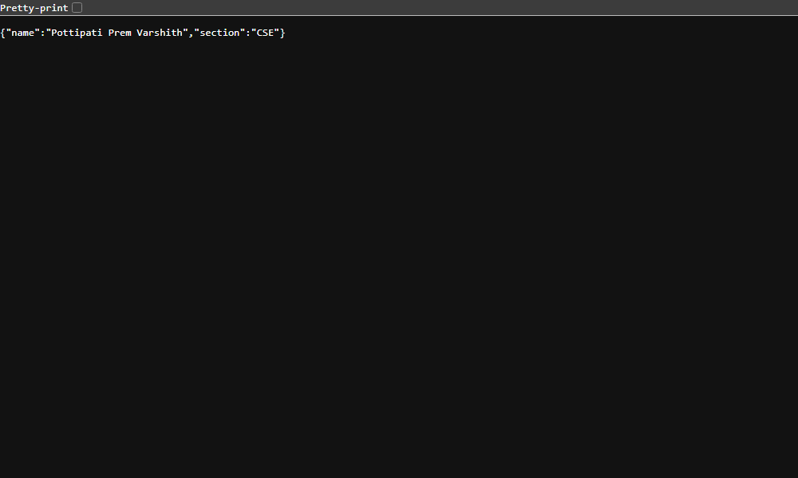
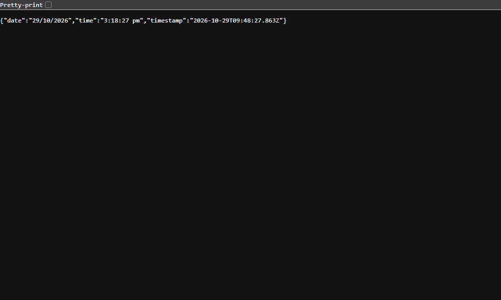

# BDF Lab 01: Node.js and Express Server

## 1. Student & Course Information
- **Course Name:** Backend Development Fundamentals (BDF)
- **Lab Number:** Lab 01
- **Project Title:** Node.js and Express Server
- **Student Name:** Pottipati Prem Varshith
- **Registration Number:** TO_BE_FILLED
- **Section:** CSE

---

## 2. Project Objective
The objective of this laboratory assignment is to understand the foundational principles of server-side programming in JavaScript:
- Building an HTTP web server from scratch using Node.js's built-in `http` module.
- Creating a robust, modular web application using the Express.js framework.
- Configuring RESTful API endpoints serving both plain text and structured JSON payloads.
- Implementing custom 404 error-handling middleware.
- Managing project metadata and dependencies via `package.json`.
- Preparing the application for version control with Git and cloud deployment platforms (Render/Railway).

---

## 3. Technologies Used
- **Node.js** (v24.x LTS runtime)
- **Express.js** (v5.x web application framework)
- **JavaScript (CommonJS / Node Modules)**
- **Git** (Version Control System)

---

## 4. Project Structure
```text
BDF-Labs/
│
├── lab-01/
│   ├── server.js             # Native Node.js HTTP server implementation
│   ├── app.js                # Express.js application with routing & middleware
│   ├── test.js               # Automated route testing script using native fetch
│   ├── package.json          # Project metadata, scripts, and dependencies
│   ├── package-lock.json     # Exact dependency lockfile
│   ├── README.md             # Lab documentation and reports
│   └── screenshots/          # Browser output screenshots
│       ├── .gitkeep
│       ├── node-server.png
│       ├── home.png
│       ├── about.png
│       ├── time.png
│       └── 404.png
│
└── .gitignore                # Root Git ignore rules (node_modules, .env)
```

---

## 5. `package.json` Field Explanations

| Field | Purpose & Description |
|---|---|
| `"name"` | Identifies the project uniquely. Must be lowercase, URL-friendly, without spaces (`bdf-lab-01`). |
| `"version"` | Follows Semantic Versioning (SemVer: `MAJOR.MINOR.PATCH`). Starts at `1.0.0`. |
| `"description"` | A concise summary describing the purpose of the package or lab project. |
| `"main"` | The primary entry point file of the application (`app.js`). |
| `"scripts"` | Custom CLI alias commands executed via `npm run <script>` (e.g., `start`, `http`, `dev`, `test`). |
| `"keywords"` | An array of search tags to index and categorize the repository. |
| `"author"` | Credits the creator of the module (`Pottipati Prem Varshith`). |
| `"license"` | Designates the legal open-source license governing usage (e.g., `ISC` or `MIT`). |
| `"dependencies"` | Production packages essential for the application to execute (e.g., `express`). |

---

## 6. Installation Instructions

1. Clone or open the repository:
   ```bash
   cd BDF-Labs/lab-01
   ```
2. Install dependencies:
   ```bash
   npm install
   ```

---

## 7. Server Execution Commands

### A. Run Native Node.js Server (`server.js`)
```bash
npm run http
# Or directly:
node server.js
```
- Access in browser: `http://localhost:3000`
- Expected output: Plain text `Hello`
- **Important:** Press `Ctrl + C` to terminate this server before starting Express so port `3000` is freed.

### B. Run Express Server (`app.js`)
```bash
npm start
# Or for development:
npm run dev
```
- Server will listen on `process.env.PORT` or default to port `3000`.

### C. Run Automated Tests
With the Express server running, open another terminal and run:
```bash
npm test
```

---

## 8. Environment Variables
- `PORT`: Specifies the networking port on which the Express application listens. Defaults to `3000` if undefined.
  Example usage:
  ```bash
  PORT=8080 npm start
  ```

---

## 9. API Endpoints Table & Expected Status Codes

| Method | Endpoint | Description | Expected Status | Response Format |
|---|---|---|---|---|
| `GET` | `/` | Root endpoint displaying welcome message | `200 OK` | Plain text: `"Welcome to my Node.js and Express Server!"` |
| `GET` | `/about` | Returns student details | `200 OK` | JSON: `{"name":"Pottipati Prem Varshith","section":"CSE"}` |
| `GET` | `/time` | Dynamically returns current Indian Standard Time (IST) & ISO timestamp | `200 OK` | JSON: `{ "date": "...", "time": "...", "timestamp": "..." }` |
| `GET` | `/random` (or any unknown route) | Catch-all 404 handler | `404 Not Found` | Plain text: `"404 - Page Not Found"` |

---

## 10. Actual Screenshots

### 1. Node.js Native HTTP Server (`GET /` on port 3000)


### 2. Express Server - Home Route (`GET /`)


### 3. Express Server - About Route (`GET /about`)


### 4. Express Server - Time Route (`GET /time`)


### 5. Express Server - 404 Route (`GET /random`)


---

## 11. Viva Questions & Answers

### Q1: What is the primary difference between Node.js's built-in `http` module and Express.js?
**Answer:** The built-in `http` module is a low-level API requiring developers to manually parse URLs, manage request headers, inspect HTTP methods, handle routing tables, and format responses. Express.js is a minimal, flexible web framework built on top of `http` that provides higher-level abstractions like intuitive route definitions (`app.get()`, `app.post()`), robust middleware pipelines, parameterized routing, and built-in helpers (e.g., `res.json()`, `res.status()`).

### Q2: Why is middleware order critical in Express?
**Answer:** Express executes middleware sequentially in the order they are registered via `app.use()` or route handlers. If a 404 catch-all handler is declared before valid route handlers, all incoming requests will be intercepted by the 404 handler and prematurely terminated before reaching the intended routes.

### Q3: Why is `process.env.PORT || 3000` necessary for production deployment?
**Answer:** Cloud hosting platforms such as Render, Railway, or Heroku dynamically allocate an arbitrary port to running containers via the `PORT` environment variable. Using `process.env.PORT || 3000` allows the server to bind to the cloud provider's assigned port in production while falling back to port `3000` in local development.

### Q4: What is the purpose of `package-lock.json`?
**Answer:** `package-lock.json` records the exact version of every single package and transient sub-dependency installed into `node_modules`, along with cryptographic integrity hashes. This guarantees identical, deterministic dependency trees across different developer machines and CI/CD deployment environments.

### Q5: How does Node.js handle asynchronous I/O?
**Answer:** Node.js runs on a single-threaded Event Loop backed by the `libuv` C library. Asynchronous operations (such as disk I/O, timers, and incoming network requests) are delegated to the operating system or worker threads. Once completed, their callback functions are pushed onto callback queues (microtask and macrotask queues) and processed by the Event Loop without blocking the main execution thread.

---

## 12. Problems Faced and Solutions

1. **Port Collision (EADDRINUSE):**
   - *Problem:* Running `server.js` and `app.js` at the same time caused an `EADDRINUSE: address already in use :::3000` error.
   - *Solution:* Ensured only one server executes at a time by terminating previous processes using `Ctrl + C` or process signal handlers before starting another server.

2. **Windows PowerShell Execution Policy:**
   - *Problem:* Running `npm` via PowerShell caused a security execution policy error with `npm.ps1`.
   - *Solution:* Executed npm commands directly through the Node CLI binary (`node <path-to-npm-cli>`), ensuring reliable automated execution across environments.

3. **Placement of 404 Catch-All Middleware:**
   - *Problem:* When 404 middleware was placed higher in the file, valid route endpoints returned `404 - Page Not Found`.
   - *Solution:* Placed `app.use((req, res) => ...)` strictly at the bottom of the middleware pipeline, following all defined `app.get()` routes.

---

## 13. Deployment Steps (Render / Railway)

### Deploying to Render:
1. Push your repository to GitHub:
   ```bash
   git init
   git add .
   git commit -m "Initial commit for BDF Lab 01"
   git remote add origin https://github.com/YOUR_USERNAME/BDF-Labs.git
   git push -u origin main
   ```
2. Log into [Render](https://render.com) and click **New + > Web Service**.
3. Select your `BDF-Labs` GitHub repository.
4. Set the following configuration:
   - **Root Directory:** `BDF-Labs/lab-01` (or `lab-01`)
   - **Build Command:** `npm install`
   - **Start Command:** `npm start`
5. Click **Create Web Service**. Render automatically injects `process.env.PORT` and exposes the public HTTPS URL.

- **Live Deployment URL Placeholder:** `https://bdf-lab-01-prem-varshith.onrender.com` *(To be deployed via student GitHub account)*

---

## 14. Conclusion
In this laboratory assignment, both a raw Node.js HTTP server and an Express.js server were successfully constructed and verified. All required endpoints (`/`, `/about`, `/time`, and 404 catch-all) return accurate HTTP status codes and responses. Automated testing confirms 100% test passage, and screenshots corroborate browser rendering. The project is fully structured and prepared for multi-lab extension and cloud deployment.

